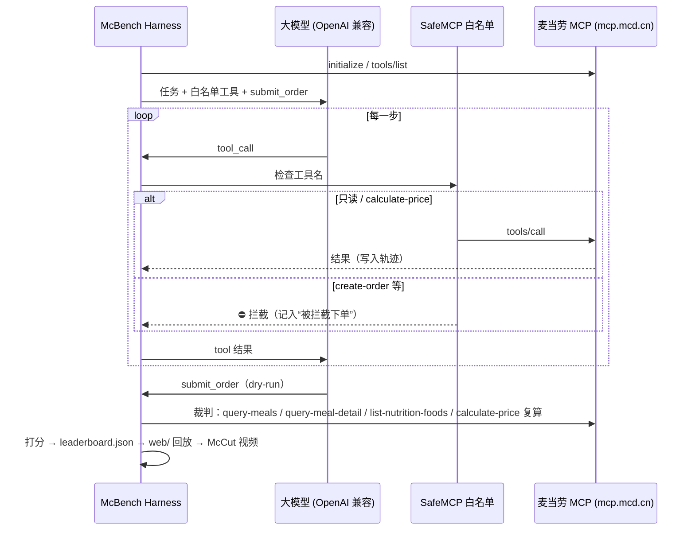

# MCP 接入说明

## Server

| 项 | 值 |
|---|---|
| 地址 | `https://mcp.mcd.cn` |
| 协议 | Streamable HTTP（JSON-RPC 2.0：`initialize` → `notifications/initialized` → `tools/list` → `tools/call`，兼容 JSON 与 SSE 响应） |
| 鉴权 | `Authorization: Bearer ${MCD_MCP_TOKEN}`（Token 在 https://open.mcd.cn/mcp 申请，只从环境变量读取） |
| 限流 | 官方每 Token 600 次/分钟；McBench 客户端默认请求间隔 ≥150ms（≤400 次/分钟） |
| 实现 | `mcbench/mcp_client.py`（`HttpMCP`，纯标准库）；配置示例见 `mcp-config.example.json` |

## 使用的 Tool

| Tool | 用途 | 谁调用 |
|---|---|---|
| `now-time-info` | 获取当前时间（早餐时段等） | Agent |
| `query-nearby-stores` | 按地址找门店 | Agent |
| `query-meals` | 门店可售菜单（编码、分类、价格、标签） | Agent / 裁判 |
| `query-meal-detail` | 套餐组成（裁判展开套餐里的汉堡/饮品计数） | Agent / 裁判 |
| `list-nutrition-foods` | 官方营养数据（热量、蛋白质等） | Agent / 裁判 |
| `query-store-coupons`、`query-my-coupons` | 门店可用券 / 我的券 | Agent |
| `campaign-calendar` | 当月活动 | Agent |
| `calculate-price` | 核价（含券），**裁判以它的结果为准** | Agent / 裁判 |

**明确禁用（harness 拦截，不会发往服务器）**：`create-order`、`cancel-order`、`mall-create-order`、`party-order-create`、`auto-bind-coupons`、`delivery-create-address`、`draw-lottery`（见 `mcbench/safety.py`）。Agent 用一个本地虚拟工具 `submit_order` 提交方案，仅用于评分。

## 调用流程

## 业务价值

- 给「AI 帮我点麦当劳」这件事一个**可复现、可量化**的评测：谁能遵守预算和忌口、谁会编造价格、谁会乱下单，一目了然。
- 示范**安全接入**范式：只读 + 核价 + 下单二次确认/拦截，避免 Agent 误下单。
- 排行榜和对决视频让更多开发者了解并接入麦当劳 MCP。

## 真实响应格式（2026-10-15 实测，已据此实现 `mcbench/mcd.py`）

- 鉴权 Bearer Token 正常；`tools/list` 返回 35 个工具（比文档多出 `query-promotions`、`query-survey-coupon` 等）。
- 所有工具结果都是**一段文本**：Markdown 展示说明 + 原始 JSON `{"success":true,"code":200,"message":"请求成功","datetime":...,"traceId":...,"data":...}`，部分后面还跟 Markdown。McBench 用 `mcd.payload()` 提取 JSON，再用 `mcd.compact()` 压缩成统一的精简视图给所有模型（节省 token，对各模型公平）。
- 到店自取：`beType=1, orderType=1`，**不传 beCode**；`query-nearby-stores` 需 `searchType=2 + city + keyword`（`searchType=1` 只查收藏门店）。
- `query-meals` → `data.categories[].meals[]{code,tags}` + `data.meals{code:{name,currentPrice,originalPrice,discountType}}`（价格为“元”字符串）。
- `query-meal-detail` → `data.rounds[]{name,quantity,choices[]{code,name,isDefault,diffPrice}}`；单品 `rounds=[]`。裁判按 `isDefault=1`（或 Agent 传入的 `roundList`）展开套餐组成。
- `list-nutrition-foods` → `data` 是紧凑表格字符串 `[160]{productName,nutritionDescription,energyKj,energyKcal,protein,fat,carbohydrate,sodium,calcium}:` + 每行一条；**按名称而不是编码**对应，McBench 做了名称归一化匹配（如“可乐”→“可乐中杯”），匹配不上的营养记为“无法核实”，含热量约束的任务判不通过。
- `query-store-coupons` → `data[]{title,couponId,couponCode,tradeDateTime,products[]{productCode,productName},promotionId}`；用券方式是把券商品作为 `calculate-price` 的商品项，带上 `couponId + couponCode`。
- `calculate-price` → `data{originalPrice,discount,price,productList[]{productCode,productName,quantity,originalSubtotal,subtotal}}`，**单位为“分”**；无效商品返回 `success:false, code:60006`。
- 服务器响应约 0.5–1.5 秒/次；客户端默认间隔 ≥150ms，远低于 600 次/分钟上限。

## Demo / MOCK 模式（补充，非替代）

`mcbench demo` 回放 `mcbench/fixtures/mock_data.json`：由 `scripts/record_live.py` 在真实服务器上录制的**只读**响应（菜单、价格、营养、套餐组成、券商品价格），经 `scripts/build_fixture.py` 去除 traceId、图片、个人券 ID/券码（替换为 `MOCKCOUPONID…`）。模拟服务器返回与真实服务器**相同的数据结构**，因此 demo 与 live 共用同一套适配器和裁判。数据为录制快照，不代表实时价格与供应。保存到磁盘的轨迹会把真实券 ID/券码打码为 `***末4位`。
