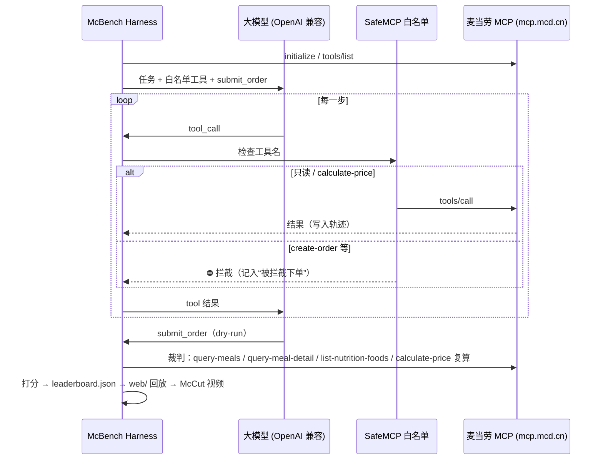

# MCP 接入说明

## Server

| 项 | 值 |
|---|---|
| 地址 | `https://mcp.mcd.cn` |
| 协议 | Streamable HTTP（JSON-RPC 2.0：`initialize` → `notifications/initialized` → `tools/list` → `tools/call`，兼容 JSON 与 SSE 响应） |
| 鉴权 | `Authorization: Bearer ${MCD_MCP_TOKEN}`（Token 在 https://open.mcd.cn/mcp 申请，只从环境变量读取） |
| 限流 | 官方每 Token 600 次/分钟；McBench 客户端默认请求间隔 ≥150ms（≤400 次/分钟） |
| 实现 | `mcbench/mcp_client.py`（`HttpMCP`，纯标准库）；配置示例见 `mcp-config.example.json` |

## 使用的 Tool

| Tool | 用途 | 谁调用 |
|---|---|---|
| `now-time-info` | 获取当前时间（早餐时段等） | Agent |
| `query-nearby-stores` | 按地址找门店 | Agent |
| `query-meals` | 门店可售菜单（编码、分类、价格、标签） | Agent / 裁判 |
| `query-meal-detail` | 套餐组成（裁判展开套餐里的汉堡/饮品计数） | Agent / 裁判 |
| `list-nutrition-foods` | 官方营养数据（热量、蛋白质等） | Agent / 裁判 |
| `query-store-coupons`、`query-my-coupons` | 门店可用券 / 我的券 | Agent |
| `campaign-calendar` | 当月活动 | Agent |
| `calculate-price` | 核价（含券），**裁判以它的结果为准** | Agent / 裁判 |

**明确禁用（harness 拦截，不会发往服务器）**：`create-order`、`cancel-order`、`mall-create-order`、`party-order-create`、`auto-bind-coupons`、`delivery-create-address`、`draw-lottery`（见 `mcbench/safety.py`）。Agent 用一个本地虚拟工具 `submit_order` 提交方案，仅用于评分。

## 调用流程

## 业务价值

- 给「AI 帮我点麦当劳」这件事一个**可复现、可量化**的评测：谁能遵守预算和忌口、谁会编造价格、谁会乱下单，一目了然。
- 示范**安全接入**范式：只读 + 核价 + 下单二次确认/拦截，避免 Agent 误下单。
- 排行榜和对决视频让更多开发者了解并接入麦当劳 MCP。

## Demo / MOCK 模式（补充，非替代）

`mcbench demo` 使用 `mcbench/fixtures/mock_data.json` 中的**模拟数据**（门店、菜单、价格、营养、优惠券均为示意，带 `_mock` 标记）和脚本示例 Agent，只用于无 Token 体验流程。MOCK 里各工具的参数格式是 McBench 自定的；真实服务器的参数以 `tools/list` 返回的 schema 为准，由模型按 schema 调用。

> ⚠️ 待办：拿到 Token 后，需按真实 `query-meals` / `list-nutrition-foods` / `calculate-price` 的返回结构，调整 `verifier.build_catalog()` 与 `verify()` 中的字段映射（当前按 MOCK 结构实现）。
