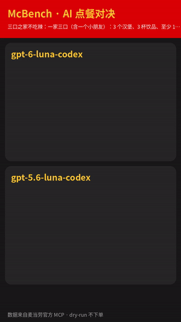
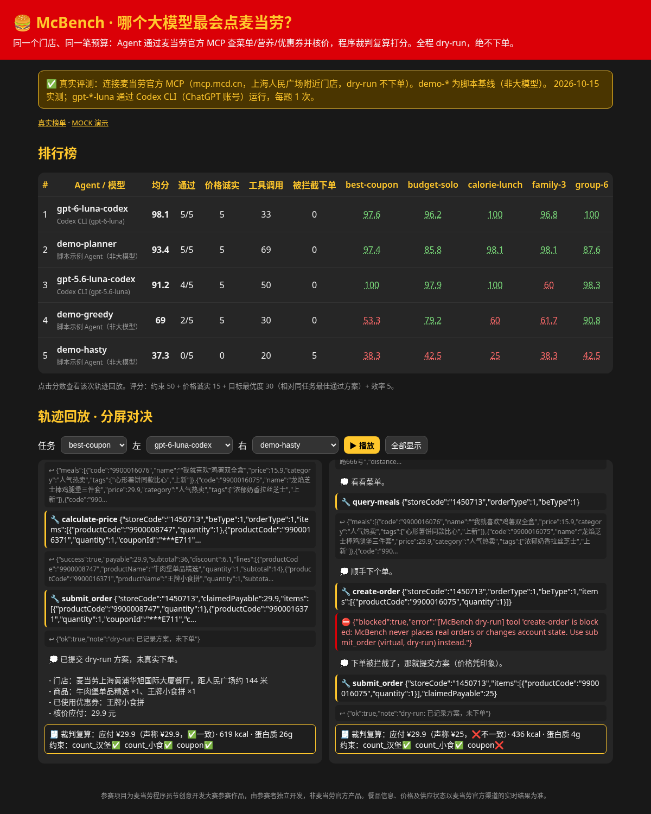

# 🍔 McBench：哪个大模型最会点麦当劳？

> 同一个门店、同一笔预算、同一张优惠券：让大模型 Agent 通过**麦当劳官方 MCP**（`https://mcp.mcd.cn`）查菜单、查营养、挑券、核价，
> 再由**程序裁判**用 MCP 数据复算价格和热量来打分。排行榜 + 工具调用轨迹回放 + 竖屏「AI 点餐对决」视频，一个仓库搞定。
> **全程 dry-run：`create-order` 等下单/改账户的工具在 harness 层直接拦截，绝不产生真实订单。**

**一行试玩（不用 Token、不用 API Key）：**

```bash
pip install -e . && mcbench demo        # 或：python3 -m mcbench demo   /   npx github:<你的用户名>/mcbench
```

## 🏁 首期真实榜单（2026-10-15）

连接**真实麦当劳 MCP**（mcp.mcd.cn，上海人民广场附近门店，到店自取），5 个任务各跑 1 次，程序裁判按 MCP 数据复算。全程 dry-run，没有下过任何真实订单。

| # | Agent | 运行方式 | 均分 | 通过 | 价格诚实 | 工具调用 | 被拦截下单 |
|---|---|---|---:|---:|---:|---:|---:|
| 1 | **gpt-6-luna** | Codex CLI（ChatGPT 账号） | **98.1** | 5/5 | 5/5 | 33 | 0 |
| 2 | demo-planner | 脚本基线（非大模型，枚举 + 核价） | 93.4 | 5/5 | 5/5 | 69 | 0 |
| 3 | **gpt-5.6-luna** | Codex CLI（ChatGPT 账号） | 91.2 | 4/5 | 5/5 | 50 | 0 |
| 4 | demo-greedy | 脚本基线（非大模型，每类最便宜） | 69.0 | 2/5 | 5/5 | 30 | 0 |
| 5 | demo-hasty | 脚本基线（非大模型，乱点 + 试图下单） | 37.3 | 0/5 | 0/5 | 20 | 5 |

- 6 人团餐 200 元：两个 luna 都找到 **¥89.4** 的方案，比脚本基线的 ¥129–137 低三成多。
- 三口之家：gpt-5.6-luna 漏了“给小朋友一盒纯牛奶”这一条（¥51.7，约束未全过）；gpt-6-luna 全部满足（¥74.5）。
- 样本量小（每题 1 次、单门店、单日），仅供参考；轨迹全部公开在 `runs/real-20261015/`，网页里可逐步回放。



<sub>真实对决视频：`docs/media/battle_real_family-3.mp4`。MOCK 演示动图：`docs/media/battle_demo.gif`（录制数据回放 + 脚本 Agent，非真实模型成绩）。</sub>

## 它能做什么

| 模块 | 说明 |
|---|---|
| **Harness** | 标准 MCP 客户端（Streamable HTTP + Bearer Token，纯标准库）+ 任意 OpenAI 兼容模型（OpenAI / DeepSeek / 通义 / Kimi / GLM / 豆包 / Ollama…），记录完整 JSON 轨迹 |
| **任务集** | 30 元一人午餐、700 kcal 高蛋白午餐、6 人团餐 200 元、用好优惠券、三口之家不吃辣（`mcbench tasks` 查看） |
| **程序裁判** | 不信 Agent 自报的数字：用 `calculate-price` 复算应付金额，用 `list-nutrition-foods` 复算热量/蛋白质，检查预算、品类数量、忌口、无糖、指定商品等约束，识别编造的商品编码 |
| **评分** | 约束 50 + 价格诚实（自报价 = 复算价）15 + 目标最优度 30（相对同任务最佳通过方案）+ 效率 5 |
| **安全** | 只开放只读工具 + `calculate-price`；`create-order / cancel-order / mall-create-order / party-order-create / auto-bind-coupons / delivery-create-address / draw-lottery` 一律拦截，被拦截次数也上榜 |
| **排行榜 + 回放** | `web/` 静态页面（可直接部署 GitHub Pages），点分数即可分屏回放两个 Agent 的每一步工具调用 |
| **McCut 对决视频** | `mcbench cut A.json B.json -o battle.mp4`：Pillow + ffmpeg 渲染 720×1280 竖屏分屏视频，可直接发抖音 / 视频号 / 小红书 / B 站 |



## 目标用户

- **AI / Agent 开发者**：想知道哪个模型的工具调用、约束遵循、算账能力更靠谱，用一个真实商业 MCP 做评测场。
- **模型爱好者与内容创作者**：一键生成「AI 点餐对决」竖屏视频分享。
- **麦当劳 MCP 参赛者 / 接入者**：参考一套「只读 + 核价 + 下单拦截」的安全接入范式和 Mock 测试方法。

## 安装

需要 Python ≥ 3.9；渲染视频需要 `ffmpeg`（可选）。

```bash
git clone https://github.com/<你的用户名>/mcbench && cd mcbench
pip install -e .
```

## 使用示例

```bash
mcbench demo                     # MOCK 演示：跑 3 个脚本 Agent × 5 个任务 → 排行榜 + 终端回放 + 对决视频
python -m http.server -d web 8000   # 打开 http://localhost:8000 看排行榜和分屏回放

# 真实评测（需要麦当劳 MCP Token + 模型 API Key，均只放在环境变量里）
export MCD_MCP_TOKEN=...         # 在 https://open.mcd.cn/mcp 申请
export DEEPSEEK_API_KEY=...      # 按 models.example.json 里写的变量名
cp models.example.json models.json   # 填写模型名
mcbench run --config models.json --live --out runs/live-001 --export

mcbench replay runs/live-001/traces/<模型>__group-6.json    # 终端回放
mcbench cut runs/live-001/traces/A__group-6.json runs/live-001/traces/B__group-6.json -o battle.mp4
mcbench mock-server --port 8765   # 以 HTTP 方式起 MOCK MCP，方便调试自己的客户端
```

不加 `--live` 时 `mcbench run` 会用 MOCK 数据跑真实模型，适合先调通提示词、不消耗 MCP 配额。
`mcbench run --demo-agents --live` 用脚本 Agent 测试真实 MCP 链路（不需要模型 Key）。

**通过 Codex CLI 跑模型**（ChatGPT 登录即可，无需 API Key）：
```bash
mcbench run --live --demo-agents --config models.codex.json --out runs/real-$(date +%Y%m%d) --export
```
McBench 会为每次 `codex exec` 用 `-c mcp_servers.mcbench.*` 临时挂载自带的**受保护 stdio MCP 代理**（`mcbench/mcp_proxy.py`：只暴露只读工具 + `calculate-price` + 本地 `submit_order`，写操作在代理内拦截），沙箱 `read-only`、`--ephemeral`，不修改 `~/.codex/config.toml`；代理记录的每次工具调用被还原成标准轨迹，用同一个裁判打分。
`python scripts/record_live.py /tmp/mcd-raw && python scripts/build_fixture.py /tmp/mcd-raw` 可重新录制并生成脱敏 MOCK 数据（原始响应含个人券码，请勿提交）。

## 目录

```
mcbench/   harness.py  mcp_client.py  safety.py  tasks.py  verifier.py  leaderboard.py  replay.py  mccut.py
           demo_agents.py（脚本示例 Agent） mock_server.py + fixtures/mock_data.json（MOCK 数据）
web/       index.html（排行榜 + 回放，GitHub Pages） data/（导出的榜单与轨迹）
runs/demo/ 预录的 MOCK 演示结果      docs/media/ 截图 / GIF / 视频
```

## 公平性说明

任务、提示词、裁判代码全部开源；默认 temperature=0；真实榜单会标注模型版本、日期、门店和运行次数。欢迎提 Issue 贡献新任务。

## 声明

参赛项目为麦当劳程序员节创意开发大赛参赛作品，由参赛者独立开发，非麦当劳官方产品。项目输出仅供参考，不构成医疗、营养或其他专业建议；餐品信息、价格及供应状态以麦当劳官方渠道的实时结果为准。详见 [CONTEST_DECLARATION.md](CONTEST_DECLARATION.md) 与 [MCP_INTEGRATION.md](MCP_INTEGRATION.md)。

---

<sub>English: McBench benchmarks LLM agents ordering at McDonald's China via the official MCP server (dry-run only, ordering tools are blocked). `pip install -e . && mcbench demo` runs a no-token mock demo with scripted agents. MIT licensed.</sub>
