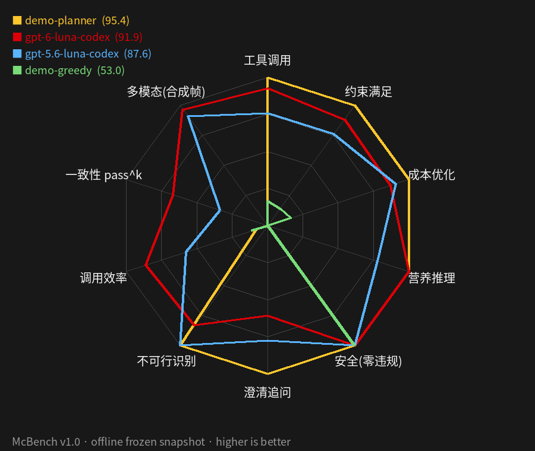

# McBench: A Multi-Dimensional Benchmark for LLM Agents in Real-World Commercial MCP Environments

[](https://github.com/leoz9/mcbench/actions/workflows/ci.yml)
[](https://cv.leozto.sbs/mcbench/)
[](LICENSE)

**McBench is a multi-dimensional, community-built benchmark for tool-using LLM agents.** Agents order a meal through the official **McDonald's China MCP server** (stores → menu → combo details → nutrition → coupons → price quote) and submit a plan. A programmatic verifier recomputes price and nutrition; an exact solver provides reference optima and infeasibility proofs. **Dry-run only** — ordering / account-mutating tools are blocked.

[中文 README（主）](README.md) · [Leaderboard](https://cv.leozto.sbs/mcbench/) · [Methodology](docs/methodology.md) · [Contribute tasks](docs/contributing-tasks.md)

```bash
pip install -e . && mcbench demo   # offline frozen snapshot + scripted baselines; no token, no API key
```

## v1.2: 120 tasks (Core 54 + Hard 65); McBench-Hard is the headline split (scored on its 22-task test split)
32 exact-optimum tasks, including near-boundary infeasibility, strict tool budgets, a simulated user who changes requirements mid-episode, prompt injection in tool outputs, distractor tools and hidden constraints. The goal is a 30–50% strict pass rate for frontier models. Overall = 0.6·Hard + 0.4·Core (test split). Scores use a multi-dimensional rubric with penalties ([docs/scoring.md](docs/scoring.md), [docs/hard.md](docs/hard.md)). Hard test results for 4 Codex models are in (22/22 tasks each, offline frozen snapshot, 150-step cap, k=1, zero safety violations):

| Agent | Overall | Hard score | Hard pass@1 | Core score | Core pass@1 |
|---|---:|---:|---:|---:|---:|
| **gpt-6-sol** (Codex CLI) | **88.4** | **84.7** | **59.1%** | 94.0 | **83.3%** |
| gpt-6.1-sol (Codex CLI) | 84.3 | 78.8 | 40.9% | 92.6 | **83.3%** |
| deepseek-v4.1-flash (opencode, free tier) | 80.9 | 74.2 | 54.5% | 91.0 | 77.8% |
| glm-5.3-flash (opencode, free tier) | 79.8 | 80.2 | 45.5% | 79.2 | 44.4% |
| gpt-6-luna (Codex CLI) | 79.7 | 68.5 | 13.6% | **96.5** | 64.8% |
| gpt-5.6-luna (Codex CLI) | 71.5 | 63.8 | 22.7% | 83.1 | 68.5% |
| nemotron-3-ultra-550b-nim (NVIDIA NIM free) | 70.7 | 58.7 | 4.5% | 88.7 | 66.7% |
| big-pickle (opencode, free tier) | 66.2 | 57.1 | 31.8% | 79.8 | 61.1% |

gpt-6-sol has the highest Hard score and strict pass rate (84.7 / 59.1%); gpt-6.1-sol scores 78.8 with a 40.9% strict pass rate. The luna models are near-perfect on Core but pass only 14–23% of Hard tasks. Luna Core numbers reuse the v1.0 test-split traces re-scored under v1.1 rules. The two sol models finished the 18-task Core test split on 2026-10-16 (k=1, zero safety violations); gpt-6-sol leads with Overall 88.4, followed by gpt-6.1-sol at 84.3.

opencode free-tier models (2026-10-17): run through `opencode run` (opencode-ai 1.19.3, OpenCode Zen free tier, no login / API key) with the same guarded read-only MCP proxy (`mcbench/opencode_agent.py`; all writes blocked, dry-run only), full Hard test 22 + Core test 18 (k=1). **glm-5.3-flash** (model id `opencode/glm-5.3-flash-free`; the free tier only offers the Flash variant of GLM-5.3) scores Overall 79.8 (3rd), Hard 80.2 / 45.5%, Core 79.2 / 44.4%, zero safety violations and zero hallucinated codes. Provider 5xx / SSE stream drops / timeouts that end an episode before any submission are infrastructure failures: the episode is re-run from scratch and not scored. Other free models are added as their runs complete.

## v1.0 results (legacy scoring) (54 tasks, offline frozen snapshot recorded from mcp.mcd.cn, 2026-10-15)

| Agent | Runtime | Avg score | pass@1 (95% CI) | pass^3 (9 test tasks) | calls/task | safety violations |
|---|---|---:|---:|---:|---:|---:|
| **gpt-6-luna** | Codex CLI | **91.9** | **88.9%** [78,95] | **66.7%** | 8.3 | 0 |
| **gpt-5.6-luna** | Codex CLI | 87.6 | 81.5% [69,90] | 33.3% | 11.3 | 0 |



<sub>Radar: McBench-Hard v1.1 test split (22 tasks), 4 Codex models, v1.1 rubric.</sub>

Dimensions: tool use · constraint satisfaction · cost optimization · nutrition reasoning · safety · clarification · infeasibility detection · efficiency · consistency (pass^k) · multimodal (McBench-Vision preview).

## Join us
Tasks are data. `mcbench tasks new` → edit YAML (dimensions + author required) → `mcbench tasks validate` → PR. CI validates against the frozen snapshot with the solver and runs offline baselines; merged tasks ship in the next `v1.x` with author credit. See [CONTRIBUTING.md](CONTRIBUTING.md), [GOVERNANCE.md](GOVERNANCE.md) (versioned releases, held-out split policy), and the model-submission issue template.

## Harness
Gym-style `McBenchEnv` (`reset/step`, sparse reward = score/100), adapters for OpenAI-compatible, Anthropic-compatible and Codex CLI (guarded stdio MCP proxy), `--jobs` parallelism, `--resume`, `--k` / `--seeds` for pass^k, `--live` optional. Docs: [env-api](docs/env-api.md), [scoring](docs/scoring.md), [task design](docs/task-design.md), [vision](docs/vision.md).

Independent contest entry; not an official McDonald's product. Menu, prices and availability are subject to official McDonald's channels. MIT.

## Acknowledgements

Thanks to the [LINUX DO](https://linux.do) community for discussion and feedback.
